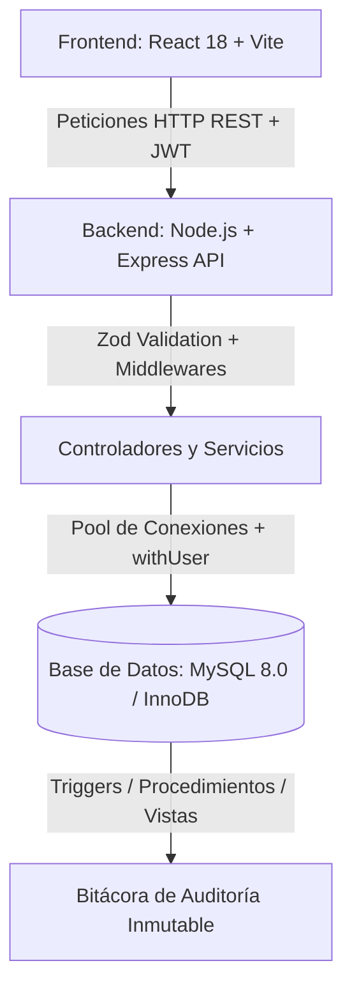

# 🧸 Juguetería Quetzal - Sistema ERP de Gestión Comercial y Control de Inventarios

> **Proyecto de Cátedra: Análisis y Diseño de Sistemas II**  
> Sistema de Planificación de Recursos Empresariales (ERP) para distribución y venta mayorista/minorista de juguetes, con arquitectura por capas, control de acceso basado en roles (RBAC), auditoría transaccional estricta en base de datos y diseño táctil interactivo.

---

## 📑 Tabla de Contenidos

- [Características Principales](#-características-principales)
- [Arquitectura y Stack Tecnológico](#-arquitectura-y-stack-tecnológico)
- [Módulos del Sistema (Sprint 1)](#-módulos-del-sistema-sprint-1)
- [Estructura del Proyecto](#-estructura-del-proyecto)
- [Requisitos Previos](#-requisitos-previos)
- [Puesta en Marcha (Instalación Rápida)](#-puesta-en-marcha-instalación-rápida)
  - [1. Base de Datos (MySQL)](#1-base-de-datos-mysql)
  - [2. Configuración del Backend](#2-configuración-del-backend)
  - [3. Configuración del Frontend](#3-configuración-del-frontend)
- [Credenciales de Demostración](#-credenciales-de-demostración)
- [Pruebas Automatizadas](#-pruebas-automatizadas)
- [Entregables y Documentación Técnica](#-entregables-y-documentación-técnica)
- [Estrategia de Ramas (GitFlow)](#-estrategia-de-ramas-gitflow)
- [Licencia](#-licencia)

---

## ✨ Características Principales

- 🔐 **Seguridad & RBAC Granular:** Autenticación JWT con expiración configurable, hashing seguro con `bcryptjs`, y autorización por permisos mapeados a roles (`Administrador`, `Supervisor`, `Operador`).
- 🛡️ **Trazabilidad y Auditoría Transaccional:** Cada operación que muta el estado del sistema (`INSERT`, `UPDATE`, `DELETE`) es registrada automáticamente por **triggers a nivel de base de datos MySQL**, asociando obligatoriamente la variable de sesión `@usuario_actual` y la dirección IP de origen.
- 🏷️ **Catálogo y Escalas de Precios por Volumen:** Sistema de precios multinivel automatizado (PVP al detalle, Mayoreo, Gran Mayorista y Distribuidor) calculado dinámicamente con correlativos inteligentes de SKU (`JUG-MAR-001`).
- 👶 **Clasificación Lúdica y Seguridad Infantil:** Selector interactivo de edad mínima en años y meses, con alertas visuales de piezas pequeñas (+3 años / primera infancia).
- 👥 **Gestión Comercial de Clientes:** Clasificación de clientes (Consumidor Final, Minorista, Mayorista), validación de NIT/CUI guatemalteco y control de límites de crédito.
- 🎨 **Living Design System Táctil:** Interfaz moderna e inmersiva inspirada en juguetería comercial (empaques blíster, tipografía *Fredoka*, switches tipo juguete, tarjetas redondeadas y microinteracciones de alta respuesta).

---

## 🏛️ Arquitectura y Stack Tecnológico

El sistema sigue una arquitectura monolítica modular desacoplada en tres capas principales:



| Capa | Tecnologías Clave | Propósito |
| :--- | :--- | :--- |
| **Frontend** | React 18, Vite, React Router v6, Axios, Lucide Icons, CSS3 Moderno | Interfaz SPA responsiva, interceptores de autenticación y manejo global de errores. |
| **Backend** | Node.js (ES Modules), Express 4, Zod, JWT, bcryptjs, Helmet, CORS | API REST validada por esquemas estrictos y middleware transaccional de auditoría `withUser`. |
| **Base de Datos** | MySQL 8.0+ / MariaDB 10.4+, InnoDB, Triggers, Stored Procedures, Views | Integridad referencial fuerte, reglas de negocio atómicas y auditoría forense inmutable. |
| **Testing** | Vitest, Supertest, Postman Collections | Pruebas unitarias de servicios, endpoints HTTP de integración y flujos E2E. |

---

## 🧩 Módulos del Sistema (Sprint 1)

El Sprint 1 implementa las Historias de Usuario nucleares del sistema:

1. **Autenticación y Sesiones (HU01, HU02, HU11):**
   - Inicio de sesión con credenciales seguras y generación de token JWT.
   - Endpoint `/api/auth/me` con recarga de perfil y matriz de permisos activos.
   - Cierre de sesión y revocación en cliente.
2. **Usuarios, Roles y Permisos (HU03 a HU10):**
   - Administración integral de usuarios (creación, edición, activación/suspensión con modal de confirmación).
   - Asignación de roles y reseteo administrativo de contraseñas.
   - Vista de matriz de roles con permisos humanos explicativos.
3. **Catálogo de Clientes (HU12 a HU14):**
   - Registro de clientes individuales y corporativos.
   - Validación de NIT/CUI y campos de contacto.
   - Configuración de límites y días de crédito comercial.
4. **Productos, Marcas y Escalas (HU15 a HU19):**
   - Generación asistida de código SKU por categoría y marca.
   - Clasificación por categorías y marcas.
   - Motor de cálculo y gestión de escalas de precio por volumen.
   - Controles de seguridad infantil y stock mínimo de reposición.
5. **Auditoría e Integridad de Datos (HU20 a HU22):**
   - Triggers de base de datos que impiden cambios no autorizados y registran cada mutación en la tabla `auditoria`.

---

## 📁 Estructura del Proyecto

```text
AnalisisII/
├── backend/                  # Servidor API Express y lógica de negocio
│   ├── scripts/              # Scripts de utilidades (seed de contraseñas)
│   ├── src/
│   │   ├── config/           # Carga de variables de entorno con validación Zod
│   │   ├── db/               # Pool de conexiones MySQL y wrapper withUser
│   │   ├── middlewares/      # Auth, RBAC, validación Zod, error handler
│   │   └── modules/          # Módulos: auth, usuarios, roles, clientes, productos
│   ├── tests/                # Suite de pruebas automatizadas con Vitest
│   ├── .env.example          # Plantilla de variables de entorno backend
│   └── package.json
├── database/                 # Definición del esquema DDL, triggers y datos semilla
│   ├── jugueteria_db.sql     # Script DDL completo con triggers y datos iniciales
│   ├── reset.ps1             # Script PowerShell para inicialización en Windows
│   └── reset.sh              # Script Bash para inicialización en Linux/macOS
├── frontend/                 # Aplicación SPA en React con Vite
│   ├── public/               # Recursos estáticos
│   ├── src/
│   │   ├── api/              # Cliente Axios con interceptores JWT
│   │   ├── components/       # Componentes Living Design System (ToySwitch, Modal, etc.)
│   │   ├── context/          # AuthContext y proveedores de estado global
│   │   ├── pages/            # Vistas (Login, Dashboard, Usuarios, Clientes, Productos, Roles)
│   │   └── styles/           # Variables CSS, diseño blister-pack y componentes UI
│   ├── .env.example          # Plantilla de variables de entorno frontend
│   └── package.json
├── docs/                     # Documentación de soporte del Sprint 1
│   └── sprint-1/             # Matriz de pruebas, bitácora de decisiones y evidencias
├── scripts/                  # Scripts en Python para generación de reportes y diagramas
├── .gitignore                # Reglas de exclusión de Git (secretos, dependencias, logs)
├── LICENSE                   # Licencia MIT
└── README.md                 # Documento principal del repositorio
```

---

## 📋 Requisitos Previos

Asegúrate de contar con las siguientes herramientas instaladas en tu equipo:

- **Node.js**: Versión `18.x` o superior (recomendado `20.x LTS` o `22.x LTS`).
- **MySQL Server**: Versión `8.0` o superior (o MariaDB `10.4+`).
- **npm**: Gestor de paquetes incluido con Node.js.
- **Git**: Sistema de control de versiones.
- *(Opcional)* **Python 3.10+**: Solo requerido si se desean regenerar los documentos `.docx` de evidencias formales mediante los scripts de la carpeta `/scripts`.

---

## 🚀 Puesta en Marcha (Instalación Rápida)

Sigue estos pasos en orden para levantar el entorno de desarrollo local:

### 1. Base de Datos (MySQL)

Asegúrate de que tu servicio MySQL se encuentre activo. Puedes importar la base de datos de dos formas:

#### Opción A: Mediante script automatizado
- **En Windows (PowerShell):**
  ```powershell
  cd database
  .\reset.ps1
  ```
- **En Linux / macOS (Bash):**
  ```bash
  cd database
  chmod +x reset.sh
  ./reset.sh
  ```

#### Opción B: Mediante cliente MySQL tradicional
```bash
mysql -h 127.0.0.1 -u root -p < database/jugueteria_db.sql
```

---

### 2. Configuración del Backend

1. Ingresa a la carpeta del backend:
   ```bash
   cd backend
   ```
2. Crea tu archivo de entorno `.env` copiando la plantilla:
   ```bash
   cp .env.example .env
   ```
   *Nota en Windows PowerShell:* `Copy-Item .env.example .env`

3. Revisa y ajusta las credenciales en `.env` según tu instalación local de MySQL:
   ```env
   PORT=3000
   DB_HOST=127.0.0.1
   DB_PORT=3306
   DB_USER=root
   DB_PASSWORD=
   DB_NAME=jugueteria_db
   JWT_SECRET=super_secreto_analisis_ii_sprint_1_jwt_key_2026
   JWT_EXPIRES_IN=8h
   NODE_ENV=development
   ```

4. Instala las dependencias:
   ```bash
   npm install
   ```

5. *(Opcional)* Sincroniza las contraseñas de los usuarios semilla si es necesario:
   ```bash
   npm run seed:passwords
   ```

6. Inicia el servidor backend en modo desarrollo con recarga automática:
   ```bash
   npm run dev
   ```
   El backend iniciará en `http://localhost:3000`. Puedes verificar su estado en `http://localhost:3000/api/health`.

---

### 3. Configuración del Frontend

1. En una nueva terminal, ingresa a la carpeta del frontend:
   ```bash
   cd frontend
   ```
2. Crea el archivo de entorno `.env`:
   ```bash
   cp .env.example .env
   ```
   *Nota en Windows PowerShell:* `Copy-Item .env.example .env`

3. Instala las dependencias del frontend:
   ```bash
   npm install
   ```

4. Inicia el servidor de desarrollo de Vite:
   ```bash
   npm run dev
   ```
5. Abre en tu navegador la URL proporcionada (por defecto `http://localhost:5173`).

---

## 🔑 Credenciales de Demostración

La base de datos incluye cuentas preconfiguradas para probar cada uno de los roles y niveles de acceso:

| Rol | Usuario / Correo | Contraseña | Permisos Destacados |
| :--- | :--- | :--- | :--- |
| **Administrador** | `admin` *(o `admin@jugueteria.local`)* | `Admin1234!` *(o `admin`)* | Acceso total: gestión de usuarios, roles, clientes, productos, auditoría y configuración. |
| **Supervisor** | `supervisor` *(o `supervisor@jugueteria.local`)* | `Admin1234!` *(o `supervisor`)* | Gestión de catálogo, compras, inventario, reportes y autorización de descuentos. |
| **Operador** | `operador` *(o `operador@jugueteria.local`)* | `Admin1234!` *(o `operador`)* | Operación en mostrador: registro de pedidos, ventas, cobros y consulta de productos/clientes. |

---

## 🧪 Pruebas Automatizadas

El proyecto cuenta con una batería de pruebas de integración con **Vitest** y **Supertest** que evalúan el flujo completo de autenticación, validación Zod, restricciones RBAC y consistencia de datos.

Para ejecutar la suite de pruebas del backend:

```bash
cd backend
npm test
```

Para ejecutar pruebas en modo continuo (watch):
```bash
npm run test:watch
```

Para consultar la matriz completa de casos de prueba y criterios de aceptación, consulta el documento:
👉 [`docs/sprint-1/matriz-pruebas.md`](docs/sprint-1/matriz-pruebas.md)

---

## 📑 Entregables y Documentación Técnica

- 📘 **Informe Formal de Entrega (Sprint 1):** [`Entrega_1_Sprint_1_Jugueteria_Quetzal.docx`](Entrega_1_Sprint_1_Jugueteria_Quetzal.docx)
- 🎨 **Guía de Estilo y Living Design System:** [`Design_System_3D_Toy_Commerce.docx`](Design_System_3D_Toy_Commerce.docx)
- 📝 **Bitácora de Decisiones Arquitectónicas:** [`docs/sprint-1/bitacora-decisiones.md`](docs/sprint-1/bitacora-decisiones.md)
- 🗄️ **Diccionario de Datos y Modelo Relacional:** [`schema_jugueteria.sql`](schema_jugueteria.sql) y [`database/jugueteria_db.sql`](database/jugueteria_db.sql)

---

## 🌿 Estrategia de Ramas (GitFlow)

El desarrollo del proyecto sigue una metodología basada en GitFlow adaptada al ciclo Scrum:

- `main`: Rama de producción estable. Contiene las versiones finales entregadas y aprobadas de cada Sprint.
- `develop`: Rama principal de integración para el trabajo continuo de desarrollo.
- `feature/*`: Ramas de características por cada parte o incremento funcional (ej. `feature/parte-1-backend-base`, `feature/parte-7-frontend-modulos`, `feature/parte-9-documentacion`).

---

## 📄 Licencia

Este proyecto se distribuye bajo los términos de la licencia **MIT**. Para más detalles, consulta el archivo [`LICENSE`](LICENSE).
